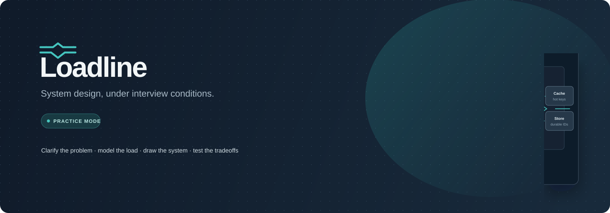

  
  
<strong>A hands-on system design interview practice space.</strong>

  
Clarify requirements · estimate scale · draw the system · test the tradeoffs

## Interface previews

### Interview workbench

The interview workspace combines a guided prompt, candidate notes, an editable architecture canvas, and live system signals.

### Problem library

Search the prompt collection, filter by difficulty, and keep track of completed practice rounds.

These interface previews are SVG artwork stored in the repository. They are designed to show the main screens and require no external image host.

## Open the site

The complete site is the root [`index.html`](index.html). It is a self-contained single-page app; no build step, server, or dependency installation is required. Open it in a modern browser. Google Fonts are optional and system font fallbacks are included.

## What you can practice

- **23 system design prompts** spanning foundational services and larger distributed systems, with search and difficulty filters.
- **A 45-minute interview flow** with five stages: requirements, capacity estimates, architecture, deep dive, and debrief. Each stage includes an interviewer prompt, suggested time, and notes area.
- **Capacity estimates** for each problem to help translate daily activity into request rates, storage, and peak load assumptions.
- **A visual architecture canvas** where you can add and connect components, change replica counts, inspect capacity and base latency, and compare monthly cost with the problem's budget.
- **A traffic simulator** that runs steady-load, traffic-spike, and replica-failure scenarios. It reports throughput, latency, errors, queue lag, and the most pressured component, then gives targeted feedback when a test misses its goal.
- **Reference designs and debriefs** that explain one viable architecture and its tradeoffs. Try your own design first; reveal or load a reference when you are ready to compare.
- **A submission history** for comparing accepted and unsuccessful attempts and their estimated costs.

## How the practice loop works

1. Pick a prompt and clarify its functional requirements and constraints.
2. Write assumptions and estimate the workload before choosing components.
3. Draw the request path and scale each tier to handle normal traffic.
4. Submit the design to run steady, spike, and component-failure tests.
5. Review the bottleneck and cost, revise the design, then debrief against a reference approach.

The simulator is a learning aid. Its component capacities, latency curves, and costs are simplified models; it does not replace discussion of API design, data modeling, consistency, durability, security, or operational ownership.

## Progress and storage

Interview stage progress, notes, canvas designs, and submissions are stored in your browser's local storage. There is no account or backend, and progress does not sync between browsers or devices. Clearing this site's browser storage removes saved practice data.

## Repository contents

| Path | Purpose |
| --- | --- |
| [`index.html`](index.html) | Complete system design practice site |
| [`assets/banner.svg`](assets/banner.svg) | GitHub repository banner |
| [`assets/previews/`](assets/previews/) | Interface preview images embedded above |
