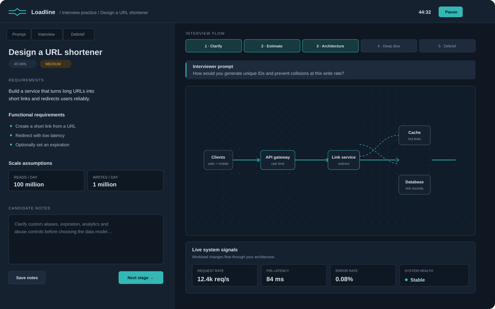
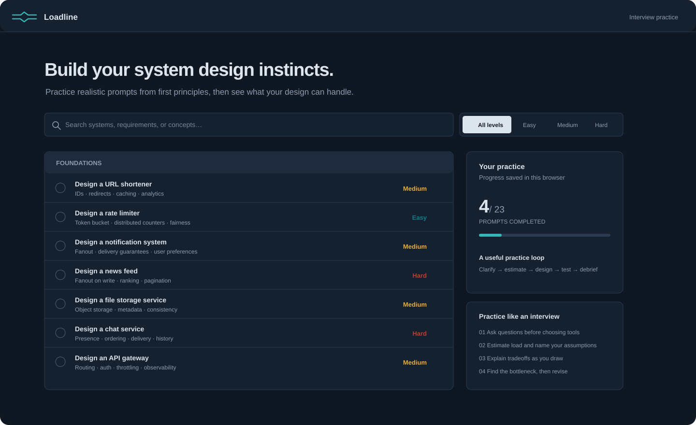

  
  
<strong>A hands-on system design interview practice space.</strong>

  
Clarify requirements · estimate scale · draw the system · test the tradeoffs

## App previews

### Interview workbench

Follow a timed interview flow, make notes, build an architecture, and see how the design responds to load.

### Problem library

Browse 23 system design prompts by difficulty and track practice progress in your browser.

## Run locally

Open `index.html` in a modern browser. There is no build step or dependency install. Google Fonts are optional; system font fallbacks are included.

## Practice flow

Each prompt guides you through clarifying requirements, estimating scale, drawing an architecture, testing load and failure scenarios, and debriefing tradeoffs. The 45-minute timer, stage progress, notes, designs, and submissions are saved in the browser using local storage.

The canvas models traffic, latency, capacity, and estimated monthly cost. It is an interview aid; API design, data modeling, consistency, and durability still need to be explained by the candidate.

## Visual assets

The repository includes its banner and app preview artwork in [`assets/`](assets/). These are local SVG files and need no external image host.
